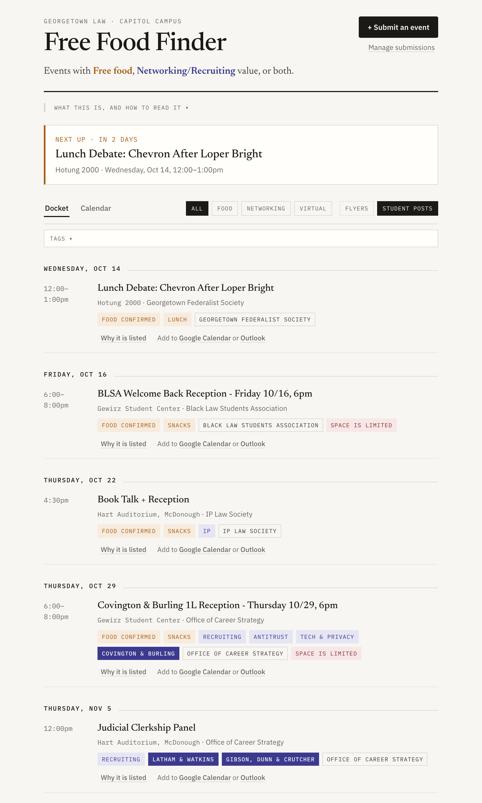

# Free Food Finder

[](https://github.com/ezfellows/free-food-finder/actions/workflows/tests.yml)

**Scan your school inbox for events with free food or people worth meeting,
and log them in one place.**

Student orgs, the career office, the dean's office and law firms announce a
dozen events a day, scattered across newsletters, flyers and the university
calendar. Free Food Finder reads them for you. It pulls out each event's date,
time and room, keeps the ones with **free food** or **networking value** (firms,
recruiters, practising lawyers, alumni), and logs them — with the exact words
that gave each one away, so you can check the call yourself.

```
$ ./fff next
tomorrow 12:00  lunch            Choosing a Practice Area                   McDonough 208            OSL flyer
     Thu 18:00  snacks           Howdy Hoyas · Simpson Thacher 1L Reception Hotung 2001              OSL flyer
    Tue 20 Oct  breakfast,lunch  HSR at 50: What Do We Know, and What Do We McCourt 125              Calendar
```

You get a terminal listing, a calendar file for your phone, and a web page you
can keep to yourself or share with your class. It was built at Georgetown Law;
everything it knows about Georgetown lives in one file, and a short profile
teaches it your school.

<picture>
  <source media="(prefers-color-scheme: dark)" srcset="docs/screenshot-dark.png">
  
</picture>

*The page, built from the made-up announcements in [`samples/`](samples/) by
[`tools/screenshot.py`](tools/screenshot.py).*

## Status

A work in progress, in daily use at Georgetown Law since September 2026.
Georgetown is the only school with a profile so far, so the template has yet
to meet a second school's inbox, and the networking side is tuned for law
students. Expect rough edges; issues and pull requests are welcome.

## What you need

- **A Mac or Linux computer** with Python 3.9 or newer. On a Mac, `python3`
  comes with Apple's Command Line Tools. No packages to install. On Windows,
  use WSL.
- **Your school email.** The hands-off way uses [Claude](https://claude.ai)'s
  desktop app with Gmail connected; otherwise you can save emails by hand.
- **A profile for your school.** Georgetown Law's is included. Writing yours
  takes an afternoon: see [Adding your school](#adding-your-school).

Flyer reading (for newsletters that send event posters as images) needs macOS.
Everything else runs anywhere.

## Quick start

Clone this repository (the green **Code** button above), then in a terminal,
inside the folder:

```bash
cp data/config.example.json data/config.json
./fff school
```

`./fff school` says which school's rules are in force. The first time, the
answer is none. Open `data/config.json` and set your school:

```json
"school": "georgetown_law"
```

Then:

```bash
./fff refresh                  # read every source into the event log
./fff next                     # what's on, with food
./fff build                    # write data/page.html; open it in a browser
./fff ics > data/docket.ics    # a calendar file to import on your phone
```

With no mail in yet, you will see only the university calendar's events, if
your school's profile has one. Email is where most events are, so the next
step is getting yours in.

## Getting your mail in

`./fff refresh` reads whatever saved emails (`.eml` files) sit in
`data/maildrop/`. There are three ways to fill it.

**1. Let Claude do it every weekday (recommended).** Connect Gmail in the
Claude desktop app, then set up the scheduled task in [`routine/`](routine/);
its README walks through it. Each run asks `./fff mailquery` what to search
for, saves the matching emails, refreshes, and (if you publish the page)
republishes it. It only searches and reads: it never sends, labels, archives
or deletes anything, and it skips anything that looks like personal
correspondence before it is ever saved.

**2. Save emails by hand.** In Gmail, open an announcement, choose
⋮ > **Download message**, and move the `.eml` file into `data/maildrop/`. Then
`./fff refresh`.

**3. IMAP**, if your school allows app passwords. Fill in the `imap_example`
block of `data/config.json` and rename it to `imap`. The password lives in the
macOS Keychain, never in a file; the top of `ingest/mail.py` explains.

After a refresh, `./fff maillog` shows every email that was read, whether it
was let in, why, and which events it produced.

## Adding your own sources

Your school's profile recognises its offices, student orgs and broadcast
systems by their addresses. Some event mail comes from places it cannot know:
a club that mails from a Gmail account, a professor's talk series, a mailing
list you joined. Add those yourself:

```bash
./fff sources add chessclub@gmail.com                          # one sender
./fff sources add-list events@lists.example.edu "Events list"  # a listserv
./fff sources                                                  # what you've added
./fff sources remove chessclub@gmail.com
```

- **A sender** is one address. Its mail is read even if the address looks
  like a person's.
- **A list** is a mailing list you are on. Everything posted to it went to
  everyone on it, so posts are read whoever wrote them — and their events are
  credited to the list, never to the classmate who sent them.

The daily routine searches Gmail for both. Adding a source changes *who* may be
read, not *what*: ID numbers, "your callback interview", calendar invitations
and replies to you alone are still kept out. `./fff sources` also lists
senders that were turned away but mail like organisations, as candidates to
add. Your sources are saved in `data/config.json`, which you can also edit by
hand.

## Your privacy, and your classmates'

Your inbox also holds grades, loan statements, a classmate's notes and a
recruiter's reply. None of it may end up in the log, let alone on a page other
people see. So:

- **Senders are refused by default.** An address has to be recognisably an
  organisation — a student org's account, a school broadcast system, a law
  firm's recruiting mailbox writing to the whole class — before its email is
  read. Your school's profile is what says how to tell an organisation's
  address from a person's. **With no profile, everything is refused** except
  the senders and lists you add with `./fff sources`.
- **Every email is checked again for personal content**, even from a trusted
  sender: an ID number, a grade, "your callback interview", a reply, a calendar
  invitation.
- **The page carries no email text.** Only titles, times, rooms, hosts and firm
  names — and those are scrubbed of addresses and links.
- **Tracking links are never followed or published.** Newsletter links carry a
  token naming you (`?qs=`, `member_id=`, Mailchimp's `e=`); following one
  registers a click in your name.
- **Nothing you collect is committed to git.** The event log, your emails, your
  settings and the built page all live in paths `.gitignore` excludes.

`./fff vet` sweeps everything logged for anything written to one person.

## Adding your school

```bash
cp schools/_template.py schools/your_school.py
```

Set `"school": "your_school"` in `data/config.json`. Every setting in the
template starts empty, and empty means "refuse" or "don't know", so a
half-finished profile is a safe one. Fill in what you can vouch for:

- **Mail:** your school's email domains, its broadcast systems, the lists that
  reach every student.
- **Campus:** your buildings and how people abbreviate them, so "MCD 208"
  becomes McDonough 208; and any other campus far enough away to matter.
- **Sources:** a LiveWhale events calendar, a newsletter of flyers.

The setting to get right before any other is **`PERSON`**: what marks a
person's email address and never an office's. At Georgetown, a student's
address always contains a digit (`ab123@`) and an office's never does
(`lawsba@`). At a school where people are `first.last@`, it is the dot. Look at
twenty senders in your own inbox before deciding — a wrong rule here is how a
classmate's email gets treated as an announcement. If nothing works, leave it
empty and add organisations one at a time with `./fff sources add`.

[`schools/georgetown_law.py`](schools/georgetown_law.py) is a complete example,
with a comment on every rule saying which real email or event forced it. Check
yours with `./fff school`, then `./fff refresh` and `./fff maillog`.

## Sharing the page

`./fff build` writes one self-contained page, `data/page.html`, plus
`data/page-files.json`, the flyer images it shows. Any static host will serve
it. Put your own introduction at the top with `"page"` in `data/config.json`.

Every event on the page links to Google Calendar and Outlook with its details
filled in, and an RSVP deadline counts down as the page is read: "RSVP by
tomorrow", then "RSVP closed".

Published as a [Claude Artifact](https://claude.ai), the page can also take
**submissions**: classmates with edit access post events, and the page
republishes itself with them. Every rebuild must then be given the live page,
or the posts are lost; the scheduled routine does this for you:

```bash
python3 publish.py data/page.html data/live.html
```

## How it decides

- **Food** comes from phrases that promise it ("lunch will be provided",
  "pizza") minus the ones that take it away ("brown bag", "bring your own"),
  graded confirmed / likely / possible.
- **Networking** comes from who will be in the room: named law firms,
  practising lawyers, recruiters, alumni. The two are judged separately; a
  clerkship panel with no food still makes the list.
- **Where** is the building *and* the room. Events on another campus are left
  out unless a firm is recruiting there.
- **Details** — dress code, resume collection, RSVP deadlines — are shown when
  an event states them, and never guessed.
- When sources disagree, a person decides: `./fff correct` records a ruling
  that outranks every source.

## Commands

| Command | What it does |
|---|---|
| `./fff school` | Which school's rules are in force, and what they say |
| `./fff refresh` | Read every source into the event log |
| `./fff next` | What's on, with food, in the terminal |
| `./fff build` | Write the page |
| `./fff ics` | The calendar file |
| `./fff mailquery` | The Gmail searches that fill `data/maildrop/` |
| `./fff maillog` | Every email read, and what became of it |
| `./fff sources` | Senders and mailing lists you've added; `add`, `add-list`, `remove` |
| `./fff senders` | Every sender seen, and why it was let in or kept out; `deny` one by hand |
| `./fff broadcast <file.eml>` | Read a newsletter of flyers (macOS) |
| `./fff flyers pending` / `apply` | Flyers too hard to read automatically, and your readings of them |
| `./fff posts` | Submissions from the page, with the evidence for each |
| `./fff titles`, `vet`, `times` | Checks: odd titles, personal content, clock disagreements |
| `./fff correct <id> <field> <value> "<why>"` | Overrule a source |
| `./fff add <events.json>` | Add events by hand |
| `./fff test` | Run the tests |

## Project layout

```
fff             the command
config.py       data/config.json, your settings
school.py       which school; schools/ holds one profile each
sources.py      senders and mailing lists you add
senders.py      who may be read: default deny, by address
personal.py     the second check, on content, for every email
score.py        food, with the phrases behind the call
network.py      networking value; contacts.py finds law firms (data/firms.json)
campus.py       building, room, and which campus
details.py      dress code, resume collection, RSVP deadlines
dateparse.py    dates and times out of English
newsletter.py   one bulletin, many events
caption.py      a flyer's caption against what OCR read
timing.py       when sources disagree about the clock
titles.py       titles that do not read like titles
posts.py        submissions from the page
store.py        the event log (SQLite), de-duplication, corrections
docket.py       assembling events for display; the refresh entry point
publish.py      the page
mailquery.py    the Gmail searches; maillog.py what came of them
ingest/         mail, broadcast (flyers), livewhale (calendar), orgs (web pages)
routine/        the scheduled task for Claude
tools/          the flyer reader's Swift source; make_eml.py, screenshot.py
tests/          run with ./fff test; GitHub runs them on every push
```

## Limits

- **The calendar reader knows LiveWhale**, which many universities use. Other
  calendar systems need an ingester; email works everywhere.
- **Flyer reading is macOS only**, and stylised lettering garbles about one
  flyer in eight; those wait in `./fff flyers pending` for a person.
- **The networking side is tuned for law students** looking for firm events.
  The food side is not.
- **A profile is only as good as the email it was tried on.** Read
  `./fff maillog` after your first few refreshes.
- **Unofficial.** Not affiliated with any school. Check the flyer before you
  walk over.

## Contributing

A profile for your school is the most useful thing you can send back: open a
pull request with `schools/your_school.py`, and say in a comment what each rule
is for. Run `./fff test` first; GitHub runs the same tests on every push and
pull request, on Linux and on a Mac. Any test you add must use made-up names
and addresses — never a real person's.

## License

MIT. See [`LICENSE`](LICENSE).
