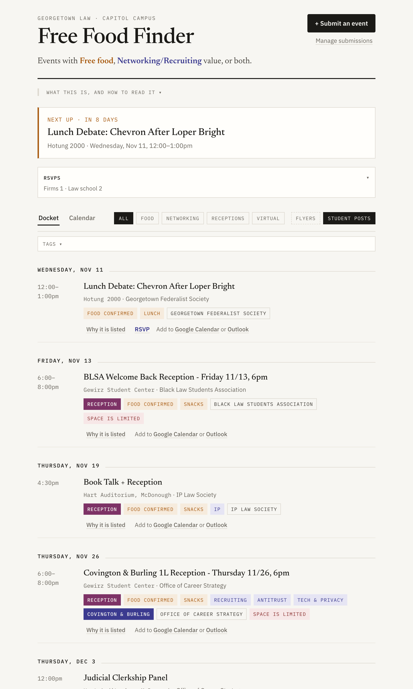

# Free Food Finder

[](https://github.com/ezfellows/free-food-finder/actions/workflows/tests.yml)

Free Food Finder tracks events on Georgetown Law's Capitol Campus that offer
free food or networking value: law firm receptions, panels with practising
lawyers, career office sessions and student organization meetings. I built it
for myself as a first-year law student, then shared the page it makes with my
classmates. It is a personal project and is not affiliated with Georgetown
Law.

## How it works

- **The public calendar.** It reads Georgetown's public events calendar feed.
- **The Student Life broadcast.** The Office of Student Life's weekly email is
  mostly flyer images. The tool downloads those images, reads their text with
  optical character recognition (OCR) and decodes any QR codes. Flyers
  attached to other emails are read the same way.
- **Recruiting and student organization email.** It reads announcements from
  approved senders, such as the career office, student organizations and law
  firm recruiting offices, and splits a newsletter into its separate events.
- **Two separate scores.** Each event gets a food score, from confirmed to
  unlikely, based on the announcement's wording. It also gets a separate
  networking score, based on the firms, recruiters, practising lawyers and
  alumni it involves. An event with no food can still be listed for its
  networking value. Each listing shows the words that put it there.
- **A weekday morning refresh.** Every weekday morning a scheduled job saves
  new mail, refreshes the list and republishes the page.

## Privacy rules

- Email is accepted only from approved senders. Everything else is refused,
  and each accepted message is checked again for personal content.
- It never opens a link decoded from a QR code, and never follows or
  publishes a tracking link made for a single recipient.
- This repository holds no email, no event database and no personal data.
  The tests use invented announcements written in the style of real ones.
  Everything the tool collects stays in a local folder that git ignores.

## Screenshot

<picture>
  <source media="(prefers-color-scheme: dark)" srcset="docs/screenshot-dark.png">
  
</picture>

*Sample data only. This page was built from the made-up announcements in
[`samples/`](samples/), not from real email.*

## Tech

- Python standard library only, with no third-party packages
- SQLite for the event store
- macOS Vision for OCR and QR decoding, through a small Swift helper
- Developed with AI coding assistance (Anthropic's Claude)

## Run it yourself

You need Python 3.9 or newer on macOS or Linux. Reading flyers needs macOS.

```bash
git clone https://github.com/ezfellows/free-food-finder.git
cd free-food-finder
cp data/config.example.json data/config.json
```

Open `data/config.json` and set `"school": "georgetown_law"`, the one school
profile included. Then:

```bash
./fff test       # run the tests
./fff refresh    # read the calendar and any saved emails in data/maildrop/
./fff next       # list what is coming up
./fff build      # write the page to data/page.html
```

The [full guide](docs/GUIDE.md) explains how to get email in, add senders,
write a profile for another school, and use every command.
